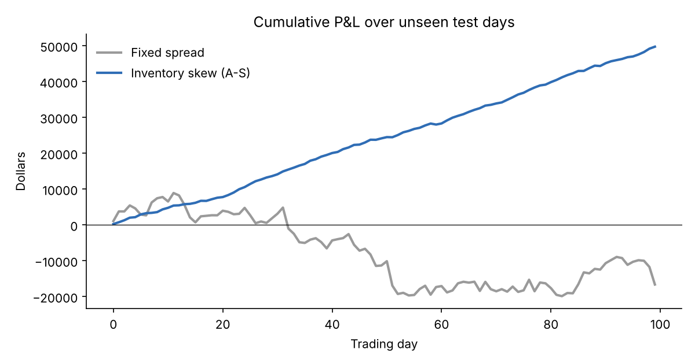
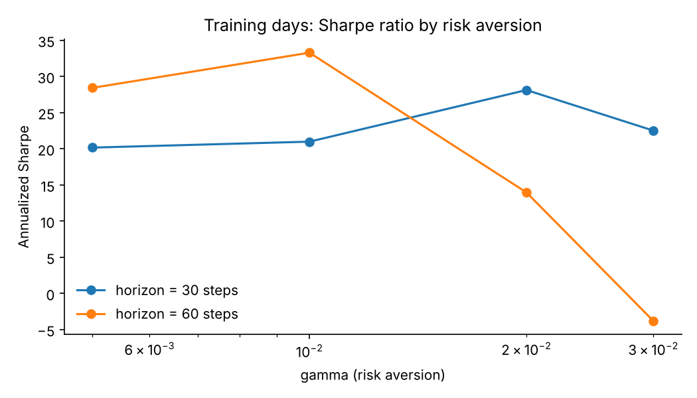
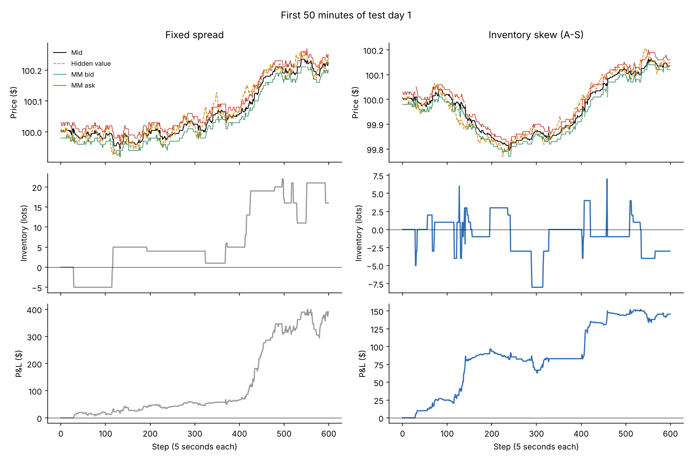
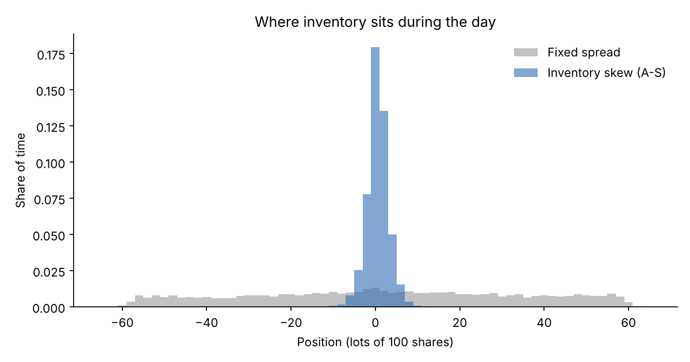

# Market Making Simulator

A Python simulation of a stock exchange where a market making bot quotes prices to buy and sell all day, earns the gap between its bid and ask, and tries not to get hurt when prices move against the shares it is holding.

I built this to understand the core problem of market making: every trade you make leaves you holding inventory, and inventory is risk. The project compares a simple fixed spread bot with an inventory aware bot based on the Avellaneda and Stoikov (2008) model, tunes it on one set of simulated days, and tests it on 100 days it has never seen.



## Results on 100 unseen test days

| Metric | Fixed spread | Inventory skew (A&S) |
|---|---:|---:|
| Mean daily P&L | -$166 | **$497** |
| Std dev of daily P&L | $1,861 | **$250** |
| Max drawdown | $28,777 | **$281** |
| Profitable days | 51% | **95%** |
| Average absolute inventory (lots) | 27.3 | **1.9** |
| Largest position (lots) | 65 | **27** |
| One minute markout per lot | +$0.61 | +$0.52 |
| Cost to flatten at the close, per day | $81 | **$3.50** |
| Annualized Sharpe ratio | -1.4 | 31.5 |

Both bots earn similar spread on each trade. The difference is inventory. The fixed spread bot keeps buying into falling prices and selling into rising ones, so it regularly sits on 30 to 60 lots and its daily P&L swings by thousands of dollars. The inventory skew bot leans its quotes to get back to flat, which cut daily P&L volatility by 87%, drawdown by 99%, and average position size by 93%.

A note on the Sharpe ratio: market makers that end every day flat really do have very high Sharpe ratios, but this number comes from a simplified simulation with no fees, no latency and no competing market makers, so treat it as a relative comparison, not a forecast.

## How the market works

Each trading day is 6.5 hours, split into 4,680 steps of 5 seconds. Prices are in ticks of $0.01 and size is in lots of 100 shares, so one tick on one lot is exactly $1.

| Participant | What it does | Why it matters |
|---|---|---|
| Hidden value | A random walk with occasional news jumps | The "true" price nobody sees directly |
| Liquidity providers | Post and cancel passive orders around a noisy guess of value | Keep the order book populated |
| Noise traders | Send random buy and sell market orders | The flow a market maker profits from |
| Informed traders | Trade only when the book is mispriced versus hidden value | Adverse selection: they pick off stale quotes |
| Market maker | Runs one of the strategies below | The thing being tested |

Everything trades through a real limit order book (`mmsim/orderbook.py`) with price and time priority, partial fills, and cancels. The market maker only cancels and replaces a quote when its price changes, so an unchanged quote keeps its place in the queue.

The random seed fixes the news and order arrivals, so both strategies face exactly the same market on a given day.

## The strategies

**Fixed spread.** Quote two ticks either side of mid and stop quoting a side if inventory hits the limit of 60 lots.

**Inventory skew (Avellaneda and Stoikov).** Quote around a *reservation price* instead of mid:

```
reservation = mid - inventory * gamma * sigma^2 * horizon
half_spread = 0.5 * gamma * sigma^2 * horizon + (1 / gamma) * ln(1 + gamma / k)
```

When the bot is long, its reservation price drops, which makes its ask more attractive to buyers and its bid less attractive to sellers, so it sells down its position. `sigma` is estimated live from an exponentially weighted average of mid price changes. The original paper uses time left until the close as the horizon; I use a rolling window (capped by time left in the day), which keeps quotes sensible at the open.

## Avoiding overfitting

Risk aversion `gamma` and the `horizon` are chosen on 40 training days (seeds 0 to 39) and then frozen. All numbers above come from 100 separate test days (seeds 100,000 and up).



Too little risk aversion behaves like the fixed spread bot. Too much and the bot skews so hard that it crosses toward the other side of the book and gives away its edge.

## What a day looks like





## Run it

```bash
pip install -r requirements.txt
python -m mmsim.run --train-days 40 --test-days 100 --out results
python -m pytest
```

The full run takes about 90 seconds on a laptop.

## Project layout

```
mmsim/
  orderbook.py    limit order book and matching engine
  market.py       agents, daily simulation loop, P&L and markout accounting
  strategies.py   fixed spread and Avellaneda and Stoikov market makers
  metrics.py      Sharpe, drawdown, win rate and other statistics
  run.py          tuning, out of sample test, charts
tests/            order book and simulation tests
results/          tables and charts from the last run
```

## Limitations and next steps

* No exchange fees or rebates, and no latency between seeing the book and quoting.
* Only one market maker. Adding a competing bot would shrink spreads.
* Informed traders follow a simple threshold rule.
* Next: add order flow imbalance as a short term signal to skew quotes, and model maker rebates.

## Reference

Avellaneda, M. and Stoikov, S. (2008). High frequency trading in a limit order book. *Quantitative Finance*, 8(3), 217 to 224.
